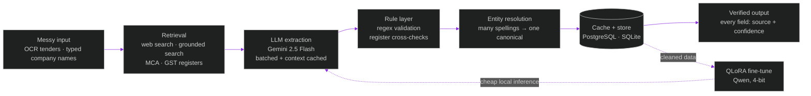

<!-- ═══════════════════════════════════ BANNER ═══════════════════════════════════ -->

<p align="center">
  
</p>

<p align="center">
  
</p>

<p align="center">
  <a href="https://sanjhladhani.netlify.app/"></a>
  <a href="https://www.linkedin.com/in/sanjh-ladhani-data-science"></a>
  <a href="https://www.kaggle.com/sanjhladhani"></a>
  <a href="https://x.com/SanjhLadhani"></a>
  <a href="mailto:sanjhladhani2020@gmail.com"></a>
  <a href="https://sanjhladhani.netlify.app/Sanjh_ladhani_resume.pdf"></a>
</p>

<p align="center">
  
  
  
  
</p>

<!-- ═══════════════════════════════════ IMPACT ═══════════════════════════════════ -->

<table align="center">
  <tr>
    <td align="center" width="200"><h2>10M+</h2><sub><b>records processed</b><br/>LLM + rules pipelines</sub></td>
    <td align="center" width="200"><h2>28K+</h2><sub><b>companies enriched</b><br/>verified, source-tagged</sub></td>
    <td align="center" width="200"><h2>153K</h2><sub><b>products canonicalized</b><br/>self-growing entity maps</sub></td>
    <td align="center" width="200"><h2>70%</h2><sub><b>manual effort cut</b><br/>n8n automation</sub></td>
  </tr>
  <tr>
    <td align="center"><h2>25K+</h2><sub><b>images trained on</b><br/>YOLO / RF-DETR</sub></td>
    <td align="center"><h2>~35%</h2><sub><b>faster inference</b><br/>batching + pipeline tuning</sub></td>
    <td align="center"><h2>92%</h2><sub><b>helmet detection accuracy</b><br/>live, in production</sub></td>
    <td align="center"><h2>🥇</h2><sub><b>1st place · ARIC 2024–25</b><br/>oral presentation</sub></td>
  </tr>
</table>

<!-- ═══════════════════════════════════ ABOUT ═══════════════════════════════════ -->

## 👩‍💻 Who I Am


I'm an **AI/ML Engineer & Data Scientist** who turns unstructured, messy information into systems that **understand, decide, and act**. My work sits at the intersection of **research, engineering, and automation** — LLM pipelines, RAG, agentic workflows, voice AI and real-time computer vision.

| | |
|---|---|
| 💼 **Now** | **AI/ML Engineer** @ **Tender247** (i-Sourcing Technologies) — LLM, RAG & automation pipelines · *Apr 2026 → Present* |
| 🧠 **Before** | **AI Intern** @ **Brainy Neurals** — computer vision & real-time inference on AWS · *Nov 2025 → Mar 2026* |
| 🎓 **Learning** | **MSc Data Science** @ Institute of Advanced Research (CGPA **9.4**) · **BCA** Gujarat University, *All-Time Ranker* (CGPA **8.94**) |
| 🏆 **Recognition** | 1st Place — ARIC 2024–25 · Prerna Award for Academic Excellence |

<br clear="right"/>

<!-- ═══════════════════════════════════ ARCHITECTURE ═══════════════════════════════════ -->

## 🧬 How I Build LLM Systems

The pattern behind my production pipelines — **the LLM interprets, deterministic rules anchor, and nothing is paid for twice.**



<table>
  <tr>
    <td width="25%" valign="top"><b>🛡️ Verify, don't guess</b><br/><sub>Unverified values stay blank. Every field carries its source and confidence.</sub></td>
    <td width="25%" valign="top"><b>⚓ LLM + rules</b><br/><sub>The model does the interpreting; deterministic logic validates and anchors every output.</sub></td>
    <td width="25%" valign="top"><b>♻️ Never pay twice</b><br/><sub>Context caching, result caching and canonical maps keep cost and latency down.</sub></td>
    <td width="25%" valign="top"><b>🔬 Distill to local</b><br/><sub>Clean LLM output becomes training data for a fine-tuned model that runs locally.</sub></td>
  </tr>
</table>

<!-- ═══════════════════════════════════ PROJECTS ═══════════════════════════════════ -->

## 🚀 Featured Work

<table>
  <tr>
    <td width="50%" valign="top">
      <h3>💊 Pharma Procurement Intelligence</h3>
      <sub><b>Gemini extraction → rules → canonicalization → QLoRA</b></sub><br/><br/>
      Turns OCR-corrupted GeM/NIC pharma tenders into clean, analysis-ready data. A ~44K-token domain-engineered prompt with batched parallel inference and context caching; regex rules ensure strengths are never invented. Self-growing maps (153K descriptions · 11K brands · 5K bidders) resolve every product, brand and firm to one canonical string.<br/><br/>
      🔬 Fine-tuned <b>Qwen with QLoRA</b> runs locally as a low-cost API alternative.<br/>
      📊 <b>10M+ records</b> · crash-resilient FastAPI + PostgreSQL + audit trail<br/><br/>
          
    </td>
    <td width="50%" valign="top">
      <h3>🏢 AI Company Intelligence Engine</h3>
      <sub><b>Company name in → verified profile out</b></sub><br/><br/>
      Researches across web search, Gemini grounded search, MCA register and GST sources to produce CIN, GST/PAN, directors, address, website, contact and status. Entity resolution maps many typed spellings to one company; register cross-checks validate the result.<br/><br/>
      ✅ Every field has a <b>source + confidence</b>; unverified stays blank.<br/>
      ♻️ Cached — no company is researched twice · <b>28K+ enriched</b><br/><br/><br/>
           
    </td>
  </tr>
  <tr>
    <td width="50%" valign="top">
      <h3>📞 AI Call Agent — n8n + Retell</h3>
      <sub><b>Production voice agent, fully automated end-to-end</b></sub><br/><br/>
      Inbound &amp; outbound calls with real-time conversational speech. Handles active/inactive user outreach, feedback collection and inquiry routing, with dynamic response logic, CRM updates and post-call data sync.<br/><br/>
         
    </td>
    <td width="50%" valign="top">
      <h3>🔗 n8n Lead-Gen Automation</h3>
      <sub><b>Capture → enrich → route</b></sub><br/><br/>
      No-code workflow with email, Google Sheets and CRM integrations that cut manual effort by <b>~70%</b>.<br/><br/>
      <h3>🗣️ SAYANK.AI — Voice Assistant</h3>
      <sub><b>Multi-modal AI assistant</b></sub><br/><br/>
      Speech recognition + TTS, NLP intent handling, live API integrations and a neural-inspired animated GUI.<br/><br/>
        
    </td>
  </tr>
</table>

<details>
<summary><b>👁️ Computer vision work (click to expand)</b></summary>
<br/>

| Project | What it does | Result |
|---|---|---|
| ⛑️ **SanjhSuraksha** | YOLOv8 PPE monitoring for open-cast mines from live video | **92% detection accuracy**, deployed |
| 🏀 **Basketball Detection & Tracking** | Player, jersey-number and action detection (RF-DETR + YOLOv8) | **mAP 0.62 → 0.78** on 25K+ images, **~35% faster** inference, on AWS EC2 + S3 |

</details>

<sub>🔎 More on my <a href="https://sanjhladhani.netlify.app/">portfolio</a> — emotion-based music &amp; book recommenders, an AES-256 steganography tool, and more.</sub>

<!-- ═══════════════════════════════════ STACK ═══════════════════════════════════ -->

## 🛠️ Arsenal

**🤖 LLMs · RAG · Agents**  


**⚙️ Automation · Voice AI · Document Intelligence**  


**👁️ Vision · ML · Data**  


**🧱 Core stack**

<p align="left">
  
</p>

<!-- ═══════════════════════════════════ NOW ═══════════════════════════════════ -->

## 🧠 Currently Building

```text
> agentic AI systems ........ LLM agents that research, verify and act
> RAG + LLM data pipelines .. structured intelligence from unstructured data, at scale
> AI calling systems ........ voice agents wired into automation workflows
> production ML pipelines ... from notebook to something that doesn't fall over
```

<!-- ═══════════════════════════════════ ACHIEVEMENTS ═══════════════════════════════════ -->

## 🏆 Recognition & Credentials

<table>
  <tr>
    <td valign="top" width="50%">
      🥇 <b>1st Place, Oral Presentation</b><br/><sub>Annual Research &amp; Innovation Conclave (ARIC) 2024–25</sub><br/><br/>
      🎖️ <b>Prerna Award</b><br/><sub>Academic Excellence — Special Category</sub><br/><br/>
      🏅 <b>All-Time Ranker</b><br/><sub>Gujarat University · CGPA 8.94</sub>
    </td>
    <td valign="top" width="50%">
      📜 <b>AI Data Engineer</b> — Reliance Foundation<br/>
      📜 <b>Deep Learning</b> — NVIDIA<br/>
      📜 <b>Introduction to Data Science</b> — Cisco Networking Academy<br/>
      📜 <b>Data Visualization</b> — Forage<br/>
      📜 <b>Emerging Technologies</b> — Code Unnati (SAP &amp; Edunet)
    </td>
  </tr>
</table>

<!-- ═══════════════════════════════════ FOOTER ═══════════════════════════════════ -->

## 🤝 Let's Build Something Real

<p align="center">
  <a href="https://www.linkedin.com/in/sanjh-ladhani-data-science"></a>
  <a href="https://sanjhladhani.netlify.app/"></a>
  <a href="https://www.kaggle.com/sanjhladhani"></a>
  <a href="https://x.com/SanjhLadhani"></a>
  <a href="mailto:sanjhladhani2020@gmail.com"></a>
</p>

<p align="center"><i>Real-world AI — not just notebooks.</i> ⚡</p>

<p align="center">
  
</p>
